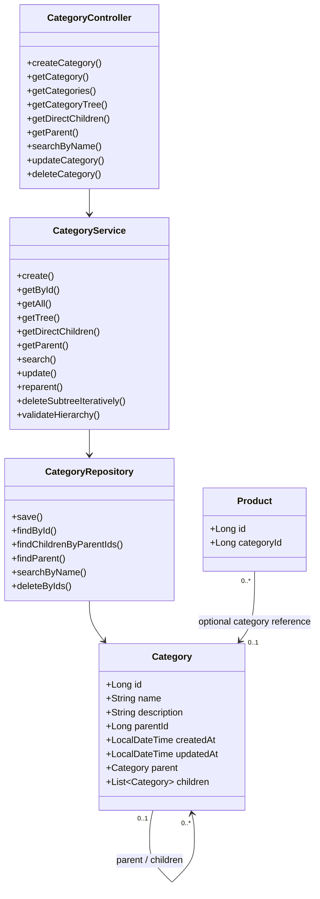
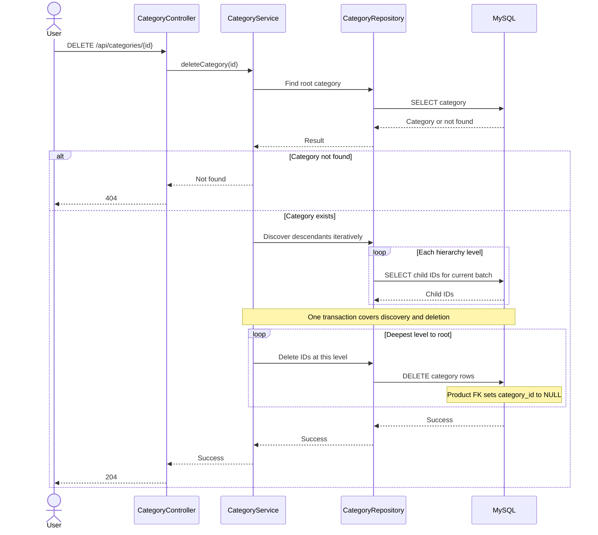
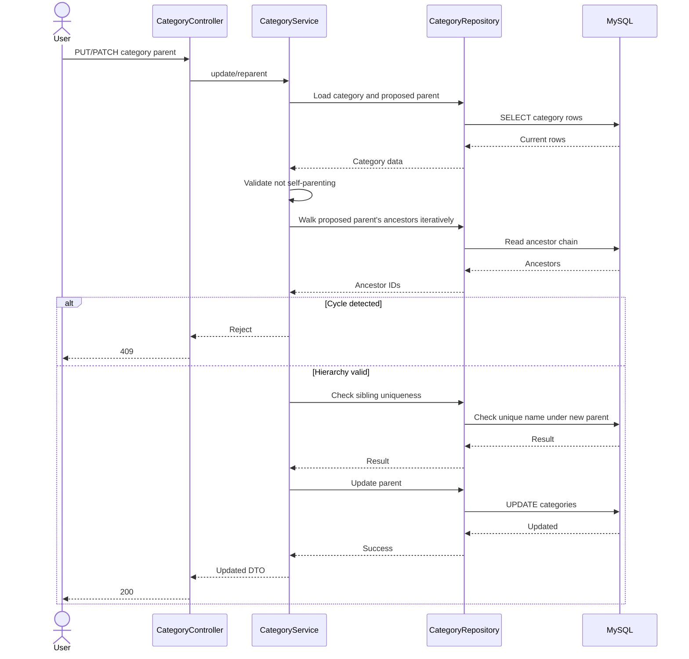
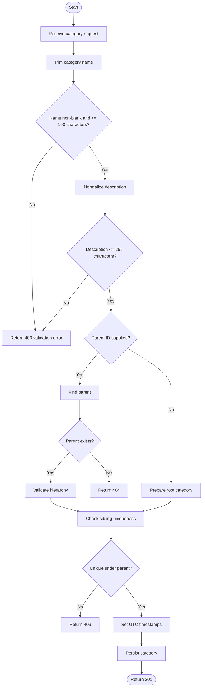

# SmartStore — Category Management
## Final Technical Specification & Implementation-Ready Design Proposal

**Document status:** Consolidated technical specification — approved requirements preserved; proposed technical resolutions clearly identified  
**Prepared:** 2026-11-10  
**Project:** SmartStore  
**Module:** Category Management  
**Language:** Arabic explanations with English technical terminology  
**Scope:** Requirements, business rules, database design, persistence, deletion strategy, API, validation, errors, testing, and implementation readiness

---

## 0. Document authority and status

This document consolidates `SmartStore-Category-Management-Review-with-UML-Updated.md` and supplies concrete technical recommendations for its open design points.

- **APPROVED:** Explicitly approved in the uploaded review; preserved here.
- **RECOMMENDED DESIGN:** A concrete solution proposed here; it was not necessarily an earlier user decision.
- **VERIFY BEFORE IMPLEMENTATION:** Must be checked against the actual repository, dependencies, MySQL instance, or a proof of concept.

This document does not authorize code changes, SQL migrations, or implementation. Explicit implementation approval is still required.

The uploaded review identifies two decision references: `Category Management — Approved Decisions Checkpoint` and `SmartStore_Category_Management_Approved_Decisions-2`. The latter is identified as the primary decision-status reference. Their full contents were not independently available during preparation, so approved decisions below are preserved as reported by the uploaded review rather than claimed as independently audited.

---

# 1. Project context and constraints

SmartStore is a local ERP / Business Management application for one grocery store in Algeria.

## 1.1 Approved architecture

**APPROVED**

- Monolithic Application.
- Layered Architecture.
- Frontend → Spring Boot Backend → MySQL.
- Backend flow: Controller → Service → Repository → Database.
- Normal business operations should work offline.
- One physical store, one local computer, and one active user initially.

Do not introduce Microservices, Clean Architecture, Hexagonal Architecture, CQRS, Event Sourcing, Redis, message brokers, Kubernetes, or cloud infrastructure without a separately justified and approved requirement.

## 1.2 Recorded technical environment

The project instructions record Java 21.0.1, Spring Boot 4.1.2, Maven Wrapper 3.10.0, MySQL 9.5.0, Spring Data JPA, Spring Web MVC, and MySQL Connector/J. Verify actual repository and installed versions before implementation. Do not upgrade them as part of this feature without approval.

## 1.3 Database constraints

**APPROVED / EXISTING PROJECT CONSTRAINTS**

- Database: `smartstore`; database user: `smartstore`.
- Credentials through `DB_USERNAME` and `DB_PASSWORD`.
- Never hardcode or commit credentials; never commit `.env`.
- Preserve `spring.jpa.hibernate.ddl-auto=none`.
- Preserve `spring.jpa.open-in-view=false`.
- Flyway is the approved migration-management direction; exact dependencies/configuration require verification.

---

# 2. Functional scope

## 2.1 Category hierarchy

**APPROVED**

Categories form a Parent / Child hierarchy. A root category has `parent_id = NULL`; a category may have zero or one parent and zero or many children. Unlimited hierarchy depth is a business requirement; no arbitrary business-level maximum may be introduced.

Example:

```text
المشروبات
└── المشروبات الغازية
    └── الكولا
        └── كولا بدون سكر
```

The relational self-reference using `parent_id` is the approved conceptual direction.

## 2.2 Approved operations

**APPROVED — all nine operations are in scope**

| ID | Operation |
|---|---|
| CAT-FR-001 | Create Category |
| CAT-FR-002 | View Category |
| CAT-FR-003 | View All Categories |
| CAT-FR-004 | Update Category |
| CAT-FR-005 | Delete Category |
| CAT-FR-006 | View Category Tree |
| CAT-FR-007 | View Direct Children |
| CAT-FR-008 | View Parent Category |
| CAT-FR-009 | Search Categories by Name |

## 2.3 Category fields

**APPROVED — exactly six domain fields**

| Field | Meaning | Nullability |
|---|---|---|
| `id` | Primary identifier | Not null |
| `name` | Category name | Not null |
| `description` | Optional description | Nullable |
| `parent_id` | Parent category reference | Nullable |
| `created_at` | Creation timestamp | Not null |
| `updated_at` | Last modification timestamp | Not null |

Do not add `code`, `image`, `sort_order`, `is_active`, or `created_by` without a justified and explicitly approved requirement. A generated technical column used for uniqueness is not a seventh domain field and must not appear in DTOs.

---

# 3. Approved business rules

## 3.1 Name

**APPROVED**

1. Name is required and must not be blank after trimming.
2. Maximum length: 100 characters.
3. Trim leading and trailing whitespace; preserve internal whitespace.
4. Do not automatically change letter case or Arabic letter forms.
5. Uniqueness is evaluated after trim normalization.
6. Names are unique among siblings and root names are unique among all roots.
7. The same name may exist under different parents.

## 3.2 Description

**APPROVED**

1. Optional; maximum length 255 characters.
2. `NULL` remains `NULL`.
3. Trim leading and trailing whitespace; preserve internal whitespace and line breaks.
4. Empty or whitespace-only values are stored as `NULL`.
5. Do not automatically rewrite text or characters.

## 3.3 Hierarchy integrity

**APPROVED**

- A category cannot be its own parent.
- Hierarchy cycles are forbidden.
- A category cannot be moved under one of its descendants.
- Re-parenting is allowed: root to child, child to another parent, and child to root.
- Descendants remain attached when their ancestor is moved.

## 3.4 Deletion

**APPROVED**

Deleting a category deletes all descendant categories at every hierarchy level.

**APPROVED — product behavior is Option B (Uncategorized)**

- Preserve Product records.
- Clear references to deleted categories.
- Affected products become Uncategorized.
- Preserve inventory, purchase, and sales records.
- Category deletion and reference cleanup must be transactionally consistent.

## 3.5 Active / inactive

**APPROVED — NOT SUPPORTED**

No active/inactive state or category archiving in this scope. Do not add `is_active`.

## 3.6 Database and timestamp decisions

**APPROVED**

- Category ID: `BIGINT AUTO_INCREMENT PRIMARY KEY`.
- Storage engine: InnoDB.
- Character set: `utf8mb4`.
- Collation: `utf8mb4_0900_ai_ci`.
- SQL timestamp type: `DATETIME`.
- Java timestamp type: `LocalDateTime`.
- UTC is the system-wide time reference.
- Spring Boot / application layer manages timestamps.
- Do not rely on MySQL `ON UPDATE CURRENT_TIMESTAMP`.

---

# 4. Recommended database schema

**Status: RECOMMENDED DESIGN — verify exact SQL against the target MySQL 9.5 instance before migration.**

The following proposal preserves the six approved domain fields and adds one generated technical column to enforce uniqueness for both root and child categories.

## 4.1 Proposed SQL

```sql
CREATE TABLE categories (
    id BIGINT NOT NULL AUTO_INCREMENT,
    name VARCHAR(100)
        CHARACTER SET utf8mb4
        COLLATE utf8mb4_0900_ai_ci
        NOT NULL,
    description VARCHAR(255)
        CHARACTER SET utf8mb4
        COLLATE utf8mb4_0900_ai_ci
        NULL,
    parent_id BIGINT NULL,

    -- Technical column: root parent NULL maps to reserved value 0.
    parent_id_unique BIGINT
        GENERATED ALWAYS AS (COALESCE(parent_id, 0)) STORED,

    created_at DATETIME NOT NULL,
    updated_at DATETIME NOT NULL,

    CONSTRAINT pk_categories PRIMARY KEY (id),
    CONSTRAINT uk_categories_parent_name
        UNIQUE (parent_id_unique, name),

    INDEX idx_categories_parent_id (parent_id),

    CONSTRAINT chk_categories_parent_positive
        CHECK (parent_id IS NULL OR parent_id > 0),
    CONSTRAINT chk_categories_not_own_parent
        CHECK (parent_id IS NULL OR parent_id <> id),

    CONSTRAINT fk_categories_parent
        FOREIGN KEY (parent_id)
        REFERENCES categories (id)
        ON DELETE CASCADE
        ON UPDATE RESTRICT
) ENGINE = InnoDB
  DEFAULT CHARACTER SET = utf8mb4
  COLLATE = utf8mb4_0900_ai_ci;
```

## 4.2 Why the generated column is recommended

A unique index on `(parent_id, name)` does not reliably enforce uniqueness for roots because MySQL permits multiple `NULL` values in a unique index.

The generated column maps:

- Root: `parent_id = NULL` → `parent_id_unique = 0`.
- Child: `parent_id = actual parent ID` → `parent_id_unique = actual parent ID`.

Real `AUTO_INCREMENT` IDs are positive and the check constraint disallows non-positive parent IDs, so `0` is reserved for the root grouping. The unique index `(parent_id_unique, name)` then enforces root-name and sibling-name uniqueness while permitting the same name under different parents.

The generated column is not user-editable and must not be included in API DTOs.

## 4.3 Collation implications

The approved collation is case-insensitive and accent-insensitive. Values considered equal by `utf8mb4_0900_ai_ci` may conflict even if their raw strings differ in case or accents. This follows the approved collation direction, but must be tested with representative Arabic, French, and English names on the actual MySQL version. Do not add additional Arabic normalization rules unless approved.

## 4.4 Character length

The limits are expressed in characters, not bytes.

**RECOMMENDED DESIGN**

- Backend validation should count Unicode code points, not UTF-8 bytes.
- In Java, use `String.codePointCount(0, value.length())` after normalization.
- Test Arabic, French, English, and supplementary Unicode characters.
- Confirm database `VARCHAR` behavior matches the intended character limit.

## 4.5 Timestamp precision

The approved SQL type is `DATETIME`. The proposal uses `DATETIME` without fractional-second precision because no fractional precision requirement was approved. Set both timestamps from the application layer; on creation they receive the same UTC value.

---

# 5. JPA persistence design

**Status: RECOMMENDED DESIGN — mapping details were previously open.**

## 5.1 Entity relationship

Use a bidirectional self-referencing relationship:

- `parent`: `@ManyToOne(fetch = FetchType.LAZY)`.
- `children`: `@OneToMany(mappedBy = "parent", fetch = FetchType.LAZY)`.

Conceptual mapping:

```java
@ManyToOne(fetch = FetchType.LAZY)
@JoinColumn(name = "parent_id")
private Category parent;

@OneToMany(mappedBy = "parent", fetch = FetchType.LAZY)
private List<Category> children = new ArrayList<>();
```

Important constraints:

1. Do not use `CascadeType.REMOVE` on the parent/children relationship.
2. Do not use `orphanRemoval = true`.
3. Do not serialize JPA entities directly.
4. Do not eagerly load the entire tree for ordinary list/detail requests.
5. Do not expose `parent_id_unique` in the API.
6. Keep DTO mapping explicit.

The database foreign key and Category Service deletion workflow own deletion integrity. JPA remove cascading must not create a second uncontrolled cascade mechanism.

## 5.2 Relationship ownership

The `parent` Many-to-One side owns the `parent_id` foreign key. `children` is the inverse side (`mappedBy = "parent"`). Keep both in-memory sides consistent when both are loaded; the database relation remains the persistence source of truth.

## 5.3 DTO mapping

Use separate Request DTOs and Response DTOs. Never return a JPA Entity directly from a Controller.

A normal Category response contains `id`, `name`, `description`, `parentId`, `createdAt`, and `updatedAt`. A tree response additionally contains `children`. Do not expose JPA relationship objects or the generated database column.

---

# 6. Safe deletion for unlimited hierarchy depth

**Status: RECOMMENDED DESIGN — resolves the most important technical risk.**

## 6.1 Problem

Unlimited hierarchy depth is approved. Relying only on a self-referencing `ON DELETE CASCADE` may encounter database limits on nested foreign-key cascade operations. A deeply nested tree must not fail merely because a database cascade chain reaches an implementation limit.

A recursive Java method is also unsuitable as the sole mechanism because sufficiently deep trees can exhaust the JVM call stack.

## 6.2 Recommended hybrid strategy

Preserve the approved FK directions:

- Category self-reference: `ON DELETE CASCADE`.
- Product-to-Category: `ON DELETE SET NULL`.

Make the Service Layer responsible for iterative, bottom-up deletion.

### Algorithm

1. Start a database transaction.
2. Find the requested category; if absent, return not found.
3. Discover descendants iteratively, level by level.
4. Do not use recursive Java method calls.
5. Record IDs grouped by hierarchy depth.
6. Delete the deepest level first.
7. Continue upward, deleting one depth level at a time.
8. Delete the requested category last.
9. Commit only if all operations succeed.

Since children are removed before their parents, the normal service workflow does not rely on a long nested cascade chain.

### Pseudocode

```text
function deleteCategory(rootId):
    begin transaction

    root = findCategory(rootId)
    if root does not exist:
        return NOT_FOUND

    levels = []
    currentLevel = [rootId]

    while currentLevel is not empty:
        levels.add(currentLevel)
        currentLevel = findChildIdsOf(currentLevel)

    for level from deepest to root:
        deleteCategoriesByIds(level)

    commit transaction
```

Batch large ID collections to avoid oversized SQL `IN` clauses.

## 6.3 Product reference handling

When the Product table and its foreign key exist:

```sql
FOREIGN KEY (category_id)
REFERENCES categories (id)
ON DELETE SET NULL
```

MySQL clears the product reference as each category row is deleted. Product records remain intact and become Uncategorized.

The Product foreign key belongs to the Product schema/migration. Do not create a fictitious Product table in the Category migration.

The Category deletion transaction must cover all category deletions. Verify the Product FK action through integration tests after the Product table exists.

## 6.4 Transaction and concurrency

The deletion operation must be transactional. For structural operations (delete and re-parent), lock affected rows where practical and handle failures without partial completion.

The initial scope is one active user at a time. Do not add distributed locking or multi-user infrastructure that is not approved.

## 6.5 Operational rule

Category deletion must be performed through the application Service/API workflow. Direct manual SQL deletion of a non-leaf category is not the supported operational path because it bypasses iterative deletion.

---

# 7. Re-parenting algorithm

**Status: RECOMMENDED DESIGN**

When moving category `C` under proposed parent `P`:

1. Confirm `C` exists.
2. If `P` is not null, confirm `P` exists.
3. Reject if `P.id == C.id`.
4. Walk upward from `P` through its parent chain iteratively.
5. Reject if `C.id` is encountered; that would create a cycle.
6. Check sibling uniqueness under the new parent.
7. Update the parent reference in a transaction.
8. Preserve all descendants of `C`.

Moving to root means setting `parent_id = NULL`.

The database unique index is the final protection against duplicate sibling names. The service performs an early duplicate check for a clear validation response, then translates the matching unique-constraint violation to HTTP 409 to cover race conditions.

Do not use recursive Java calls for cycle validation.

---

# 8. Flyway configuration and migration plan

**Status: Flyway direction APPROVED; exact dependency/configuration RECOMMENDED pending repository verification.**

## 8.1 Dependencies

Recommended MySQL Flyway dependency set:

- `org.flywaydb:flyway-core`
- `org.flywaydb:flyway-mysql`

**VERIFY BEFORE IMPLEMENTATION**

1. Inspect the actual Spring Boot 4.1.2 dependency-management BOM.
2. Check whether required Flyway artifacts and versions are managed by that BOM.
3. Inspect the effective POM and dependency tree.
4. Prefer the compatible version managed by Spring Boot where available.
5. Do not independently pin a different Flyway version without a compatibility reason.
6. Verify the MySQL-specific Flyway module is present and compatible.

Do not assume Flyway is already integrated; the previously inspected `pom.xml` did not include it.

## 8.2 Migration location and naming

**RECOMMENDED DESIGN**

Location:

```text
backend/src/main/resources/db/migration/
```

First migration:

```text
V1__create_categories.sql
```

Use Flyway versioned naming: `V<number>__<description>.sql`. Migration files are immutable after being applied to a persistent database; use a new migration to change an applied schema.

## 8.3 Configuration

Preserve:

```properties
spring.jpa.hibernate.ddl-auto=none
spring.jpa.open-in-view=false
```

Flyway owns schema creation/evolution. Hibernate must not auto-create or mutate the schema.

Safeguards:

- Do not enable Flyway `clean` for normal application use.
- Do not use Hibernate `create`, `create-drop`, or `update`.
- Do not put passwords in source-controlled properties.
- Keep credentials environment-based.
- Verify startup against an empty test database before using the existing `smartstore` database.

## 8.4 Migration sequence

1. Verify MySQL version and collation availability.
2. Add and verify Flyway dependencies/configuration.
3. Create `V1__create_categories.sql`.
4. Run against a dedicated test database.
5. Verify columns, generated column, indexes, checks, and foreign key.
6. Only then consider running against the local development database.

The Product-to-Category FK should be added by the Product migration when the Product table is introduced, unless the approved migration plan explicitly chooses otherwise.

---

# 9. API contract proposal

**Status: API direction APPROVED; paths and detailed contracts below are RECOMMENDED DESIGN.**

Base path: `/api/categories`

## 9.1 Endpoints

| Operation | Method | Endpoint | Success |
|---|---|---|---|
| Create Category | POST | `/api/categories` | 201 |
| View Category | GET | `/api/categories/{id}` | 200 |
| View flat list | GET | `/api/categories` | 200 |
| Update Category | PUT | `/api/categories/{id}` | 200 |
| Partial update | PATCH | `/api/categories/{id}` | 200 |
| Delete subtree | DELETE | `/api/categories/{id}` | 204 |
| View full tree | GET | `/api/categories/tree` | 200 |
| View direct children | GET | `/api/categories/{id}/children` | 200 |
| View parent | GET | `/api/categories/{id}/parent` | 200 or 204 |
| Search by name | GET | `/api/categories/search` | 200 |

Ensure the search route is handled distinctly from the `{id}` route.

## 9.2 Create request

```json
{
  "name": "المشروبات",
  "description": "مشروبات متنوعة",
  "parentId": null
}
```

`name` is required. `description` is optional/nullable. `parentId` omitted or null means root. A non-null parent ID must exist.

## 9.3 Update semantics

**PUT — RECOMMENDED full replacement of mutable fields**

```json
{
  "name": "المشروبات الباردة",
  "description": null,
  "parentId": 5
}
```

- `name` is required.
- `description` is supplied as a value or null.
- `parentId` is supplied as a value or null.
- `parentId: null` moves the category to root.
- Omitted fields are invalid for PUT rather than silently interpreted.

**PATCH — RECOMMENDED partial update**

Only supplied fields change:

- Omitted `name`: keep current name.
- Omitted `description`: keep current description.
- `description: null`: clear description.
- Omitted `parentId`: keep current parent.
- `parentId: null`: move to root.
- Non-null `parentId`: move under that parent.

The implementation must distinguish omitted JSON properties from explicit `null`. Use a presence-aware request representation or JSON tree. Do not add a third-party nullable-wrapper dependency without checking dependency policy.

## 9.4 Flat list and pagination

**RECOMMENDED DEFAULTS**

```text
GET /api/categories?page=0&size=20&sort=name,asc
```

- `page`: zero-based, default `0`.
- `size`: default `20`, maximum `100`.
- `sort`: default `name,asc`.
- Allow only supported fields such as `name`, `createdAt`, `updatedAt`, and `id`.
- Reject unsupported sort fields.
- Flat list responses do not recursively embed children.

The approved requirement also permits all-results retrieval.

**RECOMMENDED explicit option**

```text
GET /api/categories?all=true
```

`all=true` returns the complete flat list and must not be combined with `page` or `size`. The UI should avoid requesting it unnecessarily for large datasets.

## 9.5 Search

**RECOMMENDED**

```text
GET /api/categories/search?q=cola&page=0&size=20
```

- `q` is required and must not be blank after trimming.
- Search is by category name.
- Use the approved database collation for case/accent comparison.
- Use a parameterized query.
- Escape SQL wildcard characters if literal substring search is intended.
- Results are paginated; an explicit all-results option may be supported consistently with the flat list.

Proposed initial matching behavior: substring search (`LIKE %q%`). Revisit only if performance tests justify a change.

## 9.6 Tree

```text
GET /api/categories/tree
```

Returns a nested response:

```json
[
  {
    "id": 1,
    "name": "المشروبات",
    "description": null,
    "parentId": null,
    "createdAt": "2026-11-10T09:00:00",
    "updatedAt": "2026-11-10T09:00:00",
    "children": [
      {
        "id": 2,
        "name": "المشروبات الغازية",
        "description": null,
        "parentId": 1,
        "createdAt": "2026-11-10T09:05:00",
        "updatedAt": "2026-11-10T09:05:00",
        "children": []
      }
    ]
  }
]
```

Build the tree without recursive Java traversal where practical (for example, an ID-to-node map and iterative attachment). The nested JSON representation remains as approved.

## 9.7 Direct children and parent

- `GET /{id}/children`: return an empty array if the category exists but has no children.
- `GET /{id}/parent`: return 404 if the requested category does not exist; 204 with no body if it is a root; 200 with the parent DTO otherwise.

## 9.8 Delete

`DELETE /api/categories/{id}` deletes the category and all descendants, preserves Product records, and relies on the Product FK `ON DELETE SET NULL` once that FK exists. Return 204 on success and 404 if the requested category does not exist. The operation is transactional.

---

# 10. Error response and exception handling

**APPROVED DIRECTION:** Standard HTTP status codes, consistent error response, centralized handling with `@RestControllerAdvice`.

**RECOMMENDED response structure**

```json
{
  "timestamp": "2026-11-10T09:30:00",
  "status": 400,
  "code": "VALIDATION_ERROR",
  "message": "The request contains invalid data.",
  "path": "/api/categories",
  "fieldErrors": [
    {
      "field": "name",
      "code": "NOT_BLANK",
      "message": "Category name must not be blank."
    }
  ]
}
```

Do not expose SQL statements, credentials, stack traces, or internal exception details.

## 10.1 Status mapping

| Status | Use |
|---|---|
| 200 | Successful read/update |
| 201 | Successful create |
| 204 | Successful delete; root has no parent |
| 400 | Invalid input, malformed request, invalid pagination |
| 404 | Category or requested parent not found |
| 409 | Duplicate sibling/root name; integrity conflict |
| 500 | Unexpected server failure |

Translate the category sibling-name unique-constraint violation to 409. Do not translate every `DataIntegrityViolationException` indiscriminately; identify the relevant constraint where possible.

---

# 11. Validation specification

**APPROVED RULES; implementation approach RECOMMENDED**

| Validation | Rule | Expected response |
|---|---|---|
| Name missing | Reject | 400 |
| Name blank after trim | Reject | 400 |
| Name over 100 characters | Reject | 400 |
| Description over 255 characters | Reject | 400 |
| Empty description after trim | Normalize to null | Continue |
| Parent ID does not exist | Reject | 404 recommended |
| Category is its own parent | Reject | 400 |
| Proposed parent is a descendant | Reject | 409 |
| Duplicate sibling name | Reject | 409 |
| Duplicate root name | Reject | 409 |
| Invalid pagination | Reject | 400 |
| Unsupported sort field | Reject | 400 |

Use service-level checks for clear error messages and database constraints as final integrity protection. Centralize and test user-facing error messages.

---

# 12. UTC timestamp implementation

**APPROVED:** UTC convention, Java `LocalDateTime`, SQL `DATETIME`, application-managed values.

**RECOMMENDED IMPLEMENTATION**

- Obtain current time from an injectable Java `Clock` configured to UTC.
- Generate values using `LocalDateTime.now(clock)` where the clock is UTC.
- Set `created_at` and `updated_at` on creation.
- Update only `updated_at` on modification.
- Do not use MySQL automatic timestamp updates.
- Treat persisted `DATETIME` values as UTC by application convention.
- Convert UTC to `Africa/Algiers` only for user-facing display where needed.

`LocalDateTime` carries no timezone. Therefore, document API timestamp strings as UTC values even though serialized `LocalDateTime` text has no offset. Do not append `Z` unless the actual DTO type is changed to an offset-aware type through an approved contract.

Use an injectable `Clock` so tests can assert exact timestamp behavior.

---

# 13. Testing strategy

**APPROVED:** Unit Tests and Integration Tests.

API Tests are not a separately approved required test category; Controller behavior may still be covered by integration tests.

## 13.1 Unit tests — Service

### Create
- Valid root and child.
- Missing name and whitespace-only name.
- Name trimming.
- Description trimming and empty-to-null.
- Name boundaries: 100 accepted, 101 rejected.
- Description boundaries: 255 accepted, 256 rejected.
- Missing parent.
- Duplicate sibling and duplicate root.

### Update / Re-parent
- Rename and description update.
- Move root under another category.
- Move child under another parent.
- Move child to root.
- Reject self-parenting.
- Reject moving under a descendant.
- Reject duplicate name under new parent.
- Preserve descendants after move.
- Verify PUT/PATCH semantics, including omitted vs null fields.

### Read / Search
- Existing and missing category.
- Flat list.
- Direct children.
- Root parent behavior.
- Search with no result.
- Search pagination.
- Nested tree.

### Delete
- Delete leaf.
- Delete category with one child.
- Delete multi-level subtree.
- Delete a very deep hierarchy without recursive Java calls.
- Missing category.
- Rollback when a deletion step fails.
- Verify Product preservation and null category references when Product FK exists.

## 13.2 Integration tests — real MySQL

Generated columns, collation, check constraints, and foreign keys are database-specific and must be tested against MySQL.

**RECOMMENDED TEST SAFETY**

- Use a dedicated test database such as `smartstore_test`.
- Never point destructive integration tests at the normal `smartstore` development database.
- Do not add Testcontainers or Docker as a project dependency without approval.
- Use the installed MySQL test instance/configuration unless another test infrastructure is approved.

Verify:

1. Migration succeeds on an empty schema.
2. Generated column computes root/child grouping correctly.
3. Duplicate root name is rejected.
4. Duplicate sibling name is rejected.
5. Same name under different parents is accepted.
6. Case/accent behavior matches the selected collation.
7. Invalid parent values are rejected.
8. Bottom-up deletion works.
9. Product FK `ON DELETE SET NULL` works after Product schema exists.
10. Transaction rollback leaves hierarchy consistent.
11. UTC timestamps are stored/read consistently.

## 13.3 Deep hierarchy test

Create a hierarchy substantially deeper than ordinary store usage and verify create, tree retrieval, re-parent validation, and deletion without recursive Java stack overflow. The test depth is a stress-test parameter, not a newly imposed product limit.

---

# 14. Frontend scope

**APPROVED DIRECTION:** Category Management combines Hierarchical Tree View and Table View.

**RECOMMENDED MVP interactions**

- Display category tree.
- Select a category to view details.
- Create root category.
- Create child under selected parent.
- Edit name and description.
- Move category to another parent or root.
- Delete with confirmation explaining that all descendants will be deleted.
- Explain in confirmation that products are preserved and become Uncategorized.
- Search by category name.
- Switch between Tree View and Table View.

Do not add active/inactive controls, category images, sorting-order fields, or category codes. Detailed visual styling can be handled during frontend implementation.

---

# 15. Security and operational scope

- Authentication and authorization are deferred for this module.
- This deferral is not approval to expose the application to an untrusted network.
- Keep the application local as intended.
- Backup and recovery are system-level requirements, not Category-specific implementation.
- Do not log passwords or sensitive configuration.
- Do not expose SQL/database internals in API errors.

---

# 16. Updated UML

These diagrams reflect approved requirements plus recommended design.

## 16.1 Class diagram



## 16.2 Delete sequence diagram



## 16.3 Re-parent sequence diagram



## 16.4 Create activity diagram



---

# 17. Decision register

| Area | Status |
|---|---|
| Hierarchical categories | APPROVED |
| Unlimited hierarchy depth | APPROVED |
| Nine category operations | APPROVED |
| Exactly six Category domain fields | APPROVED |
| Required, non-blank name | APPROVED |
| Name maximum 100 characters | APPROVED |
| Name normalization | APPROVED |
| Sibling uniqueness, including roots | APPROVED |
| Description optional, max 255 | APPROVED |
| Description normalization | APPROVED |
| No self-parenting | APPROVED |
| No hierarchy cycles | APPROVED |
| Re-parenting allowed | APPROVED |
| Recursive descendant deletion | APPROVED |
| Product preserved / Uncategorized | APPROVED |
| Active/inactive not supported | APPROVED |
| BIGINT AUTO_INCREMENT | APPROVED |
| InnoDB | APPROVED |
| utf8mb4 / utf8mb4_0900_ai_ci | APPROVED |
| DATETIME / LocalDateTime / UTC | APPROVED |
| Spring Boot manages timestamps | APPROVED |
| Generated Column for root uniqueness | APPROVED DIRECTION |
| Category FK ON DELETE CASCADE | APPROVED DIRECTION |
| Product FK ON DELETE SET NULL | APPROVED DIRECTION |
| Hybrid database + Service deletion | APPROVED |
| Bidirectional JPA relationship | APPROVED DIRECTION |
| Flyway | APPROVED DIRECTION |
| PUT and PATCH | APPROVED |
| Flat list + separate nested tree | APPROVED |
| Search + pagination + all-results option | APPROVED |
| Request DTOs / Response DTOs | APPROVED |
| Standard HTTP errors and centralized advice | APPROVED |
| Unit + Integration tests | APPROVED |
| Tree View + Table View | APPROVED DIRECTION |
| Exact SQL schema in Section 4 | RECOMMENDED DESIGN |
| Iterative bottom-up deletion in Section 6 | RECOMMENDED DESIGN |
| Re-parenting algorithm in Section 7 | RECOMMENDED DESIGN |
| JPA mapping details in Section 5 | RECOMMENDED DESIGN |
| API endpoint details in Section 9 | RECOMMENDED DESIGN |
| Error JSON in Section 10 | RECOMMENDED DESIGN |
| Validation mapping in Section 11 | RECOMMENDED DESIGN |
| Flyway dependency/configuration details | VERIFY BEFORE IMPLEMENTATION |
| Actual compatibility with repository versions | VERIFY BEFORE IMPLEMENTATION |
| MySQL generated-column/index/check behavior | VERIFY BEFORE IMPLEMENTATION |
| Product FK integration | VERIFY WHEN PRODUCT TABLE EXISTS |

---

# 18. Implementation checklist

Do not begin implementation until these checks and approvals are complete.

## 18.1 Repository verification

- [ ] Inspect current `pom.xml`.
- [ ] Verify actual Java and Spring Boot versions.
- [ ] Verify actual MySQL server version.
- [ ] Verify MySQL collation `utf8mb4_0900_ai_ci` is available.
- [ ] Verify current database objects; do not assume it is still empty.
- [ ] Verify `ddl-auto=none` and `open-in-view=false`.
- [ ] Verify whether Flyway has since been added.
- [ ] Verify Git working tree before modifying files.

## 18.2 Database proof of concept

- [ ] Execute proposed DDL on a disposable test schema.
- [ ] Verify generated column expression.
- [ ] Verify unique root names.
- [ ] Verify sibling uniqueness.
- [ ] Verify same names under different parents are allowed.
- [ ] Verify check constraints.
- [ ] Verify self-referencing foreign key.
- [ ] Verify Arabic/French collation behavior.
- [ ] Verify iterative bottom-up deletion.
- [ ] Verify rollback behavior.

## 18.3 Design approval

- [ ] Approve or amend exact Category DDL.
- [ ] Approve iterative deletion workflow.
- [ ] Approve JPA mapping.
- [ ] Approve Flyway dependency/configuration after compatibility verification.
- [ ] Approve API paths and PUT/PATCH semantics.
- [ ] Approve pagination and search behavior.
- [ ] Approve error response structure.
- [ ] Approve validation mapping.
- [ ] Approve Unit and Integration test plan.
- [ ] Confirm Product migration will create nullable Category FK with `ON DELETE SET NULL`.
- [ ] Explicitly authorize implementation.

---

# 19. Implementation sequence after approval

1. Re-inspect current repository and relevant documentation.
2. Verify MySQL and Flyway compatibility.
3. Prove proposed Category DDL on a disposable test database.
4. Add Flyway dependencies/configuration.
5. Add Category migration.
6. Run migration and verify schema.
7. Implement Category Entity and Repository.
8. Implement Category Service and business rules.
9. Implement Controller, Request DTOs, Response DTOs, and exception handling.
10. Add Unit Tests and MySQL Integration Tests.
11. Verify all nine operations and hierarchy edge cases.
12. Review frontend Tree View and Table View integration.
13. Synchronize Obsidian documentation with actual implementation.
14. Review Git diff and ensure no secrets or unrelated files are included.
15. Commit with a meaningful Conventional Commit message when approved.

Do not create DEC-068 automatically. Do not reset Git history or force-push.

---

# 20. Final status

This document provides a complete proposed technical resolution for the open Category Management design areas while preserving approved business decisions.

**It is a design proposal ready for technical review, not proof that the design has been tested against the live repository or database.**

The most important technical resolution is deletion: iterative descendant discovery and bottom-up deletion inside one transaction, rather than relying on a deep recursive Java call or a long nested database cascade.

The remaining verification work is concrete: compatibility and proof-of-concept checks against the actual repository and MySQL instance. Once those checks pass and the user approves the design, Category Management can proceed to Flyway migration and implementation.

**End of document.**
